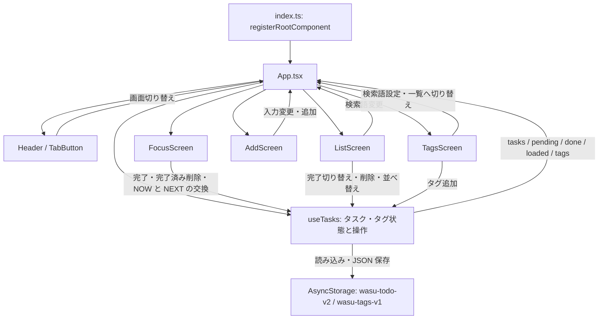

# ichido のアーキテクチャ

最終更新: 2026-11-06（追加画面のタグ入力ツールバーと B1〜B9 の検証を反映）

## アプリの概要

ichido は「いま取り組むタスクを一つに絞る」ためのタスク管理アプリ。Expo と React Native で実装し、タスクの追加、完了・未完了の切り替え、削除、並べ替え、部分一致検索、タグの登録と入力補完を提供する。起動時は「いまやる」画面を表示し、未完了タスクの先頭を NOW、次のタスクを NEXT として提示する。本文の `#名前` から `Task.tags` を作り、「いまやる」ではタグ1つの完全一致で絞り込める。NEXT をタップすると、絞り込み後の NOW と順番を交換する。

タスクとタグ履歴は端末内の AsyncStorage に保存する。バックエンド、外部 API 通信、ユーザー認証、端末間同期の実装はない。

## 技術構成

バージョンは `package.json` の指定に基づく。

| 技術 | 指定バージョン | 用途 |
| --- | --- | --- |
| Expo | `~54.0.33` | 起動、開発、ネイティブビルドの基盤 |
| React | `19.1.0` | コンポーネントとフックによる UI・状態管理 |
| React Native | `0.81.5` | UI、アニメーション、キーボード対応 |
| TypeScript | `~5.9.2` | 型定義。Expo の基本設定を継承し `strict: true` を指定 |
| AsyncStorage | `^2.2.0` | タスク配列とタグ履歴の永続化 |
| react-native-svg | `^15.15.3` | 共通アイコンの描画 |

`expo-status-bar` も依存関係に含まれるが、現在の `App.tsx` は React Native の `StatusBar` を使用する。ルーティングやグローバル状態管理専用のライブラリは導入していない。

## ディレクトリ構成

```text
ichido/
├── index.ts                 # Expo にルートコンポーネントを登録
├── App.tsx                  # 画面切り替え、入力・検索状態、フックと画面の接続
├── screens/
│   ├── FocusScreen.tsx      # タグチップ、現在・次のタスク、順番交換、完了操作、空状態
│   ├── ListScreen.tsx       # 一覧、部分一致検索、完了切り替え、削除、上下移動
│   ├── AddScreen.tsx        # 複数行入力、フォーカス中の # ボタン・履歴/候補ツールバー
│   └── TagsScreen.tsx       # タグ追加、タグから一覧検索への遷移
├── hooks/
│   └── useTasks.ts          # タスク・タグ状態、読み込み、更新、保存、表示順の計算
├── components/
│   ├── Header.tsx           # タイトル、未完了件数、画面切り替えタブ
│   ├── TabButton.tsx        # 共通タブボタン
│   └── Icons.tsx            # SVG アイコン
├── types/
│   └── index.ts             # Task 型、View 型
├── constants/
│   └── colors.ts            # 共通カラーパレット C
├── utils/
│   ├── tags.ts              # タグ抽出・候補検索・補完・ツールバー状態・カーソル挿入
│   ├── focus.ts             # 完全一致タグ絞り・候補タグ・NOW/NEXT選択・順番交換・生成
│   └── search.ts            # タスク本文の部分一致検索
├── tests/
│   ├── tags.test.mjs        # タグ処理のテスト（T1〜T9、既存補完を B9 として検証）
│   ├── tagInput.test.mjs    # ツールバー用純関数のテスト（B1〜B8）
│   ├── focus.test.mjs       # 絞り込み・順番交換・タスク生成のテスト（T10〜T17）
│   └── search.test.mjs      # 部分一致検索のテスト
├── assets/                  # アイコン、スプラッシュ、favicon の PNG
├── app.json                 # Expo と各プラットフォームの設定
├── eas.json                 # EAS ビルド・提出設定
├── package.json             # 依存関係と開発コマンド
├── package-lock.json        # npm の依存関係ロック
├── tsconfig.json            # TypeScript 設定
├── usbinstall.sh            # Android release APK のビルドと USB 実機へのインストール
├── .env.usbinstall.example  # USB インストール用ローカル設定のひな形
├── README.md                # アプリのコンセプトと機能・検証方法
├── AGENTS.md                # コード修正時の本書更新ルール
└── ARCHITECTURE.md          # 本書
```

## コンポーネントとデータの流れ



画面からのタスク操作は、`App.tsx` が渡すコールバックを通して `useTasks` を呼び出す。画面コンポーネントはストレージを直接操作しない。

### 起動と画面切り替え

`index.ts` が Expo の `registerRootComponent(App)` を呼び出す。`App.tsx` は `useTasks` を一度呼び出し、その結果を各画面に渡す。保存データの読み込みが終わり `loaded` が `true` になるまでは `null` を返すため、専用の読み込み画面は表示しない。

画面は `View` 型の `"focus" | "list" | "add" | "tags"` を React の `useState` で保持し、条件付きレンダリングで切り替える。初期値は `"focus"`。URL やナビゲーションスタックによる遷移ではない。

`App.tsx` はタスク入力中の文字列と一覧の検索語 `query` も保持する。追加操作で改行ごとに分割し、各行の前後の空白と空行を除いて `addTasks` に渡す。追加後は入力を空にして「いまやる」画面へ戻る。検索語は画面を切り替えても保持する。入力途中の文字列、検索語、選択中の画面は永続化しない。タグ選択 `selectedTag: string | null` も `App.tsx` の `useState` に保持し、画面切り替えで維持するが永続化しない。選択タグを使う未完了タスクがなくなると解除する。同じ描画で有効な選択を導出し、解除前の空の NOW を表示しない。有効な選択は現在のチップの表記から選ぶため、先頭タスクの完了でタグ表記の大文字小文字が変わっても再タップで解除できる。

### 各画面の責務

| 画面 | 主な動作 |
| --- | --- |
| `FocusScreen` | 上部の横1行・横スクロールのチップで未完了タスクに使われるタグだけを表示する。単一選択で絞り、再タップで解除する。`pickFocus` が返す NOW/NEXT を表示し、NOW の完了と NEXT の交換も絞り込み後の対象に作用する。タスクがない場合は追加への導線、全件完了時は完了済みの削除ボタンを表示する |
| `ListScreen` | 未完了・完了済みを含む一覧を本文の部分一致で検索する。検索クリア、検索結果件数、該当なし表示を提供する。完了状態の切り替え、個別削除、完了済み一括削除、上下ボタンによる並べ替えを提供する |
| `AddScreen` | 複数行のテキスト入力と追加ボタンを表示。空白のみの入力ではボタンを無効化し、表示後に入力欄へフォーカスする。入力欄にフォーカスがある間だけ、直下に # ボタンと横スクロールのタグチップを1行表示する。通常は登録履歴、タグ入力中は前方一致候補を表示し、挿入・補完後もフォーカスとカーソル位置を維持する |
| `TagsScreen` | タグ名を入力して追加し、登録済みタグを一覧表示する。タグをタップすると検索語を `#タグ名` に設定して一覧へ切り替える。無効な名前や登録済みの名前は追加できない |

一覧画面の個別削除と完了済み一括削除は `Alert.alert` で確認する。「いまやる」画面の完了済み削除は確認を挟まず実行する。

### 検索とタグ

`utils/search.ts` の `filterTasks` は検索語の前後の空白を除き、検索語と本文を NFC 正規化して小文字に変換し、`includes` で部分一致を判定する。空の検索語では全件を返し、結果の表示順とタスクオブジェクトは維持する。一覧検索では、`#仕事` を検索すると `#仕事用` も一致する。

検索中の並べ替えでは、表示されている移動元と隣接タスクの ID から全件一覧のインデックスを求め、`reorderTasks` に渡す。完了済み一括削除は検索結果にかかわらず全件が対象で、ボタンにも「すべての完了済み」と表示する。

タグはタスク本文中の `#名前` として入力し、追加時に抽出した名前を必須の `Task.tags: string[]` に保存する。本文中の記法は消さずに残す。`utils/tags.ts` は行頭または空白直後の `#` のみを認識し、日本語を含む文字・数字・結合文字・`_`・`-` をタグ名として扱う。単語途中や URL 内の `#`、直後が空白の `# 見出し`、連続する `##a` は抽出しない。タグ名は NFC 正規化し、大文字・小文字を区別せず重複を除去し、最初の表記を保つ。手動追加では前後の空白と先頭の `#` を1つだけ除去して検証する。

タスク追加時に `Task.tags` を履歴へ登録する。手動追加したタグも同じ履歴を使う。履歴は初回登録の古い順で末尾に追加し、既存タグの再使用では並べ替えない。保存と復元でもこの順序を維持する。タグ管理画面の入力値は画面内の状態で保持し、画面を離れると破棄する。

追加画面の入力補助は `utils/tags.ts` の純関数で計算する。`insertAtCursor` は選択範囲を置換し、挿入直後にカーソルを折りたたむ。`insertHash` は行頭・空白直後なら `#`、それ以外なら ` #` を挿入する。`toolbarState` は既存の `getActiveTag` と `suggestTags` を再利用し、カーソルまでのタグ名を NFC・大文字小文字を無視した前方一致で検索する。タグ内は `prefix`、それ以外は `history` とし、候補はどちらも新しい登録順に返す（履歴配列は変更しない）。`#` 単独では全候補を表示し、他の行のタグ、単語途中や URL 内の #、範囲選択はタグ入力中とみなさない。

`applyTagChip` はタグ内なら既存の `completeTag` を再利用してトークン全体を置換し、タグ外なら `insertHash` の境界規則で挿入する。どちらも `#タグ名 ` の末尾の半角空白直後にカーソルを置く。補完時に後続の半角空白があれば1つ再利用し、タブ・改行は維持してその手前に半角空白を付ける。既存の `completeTag` 自体の空白・タブ再利用の動作は維持する。

`AddScreen` は選択範囲、補完時の一時的な制御用 selection、入力欄のフォーカス状態をローカル状態として持つ。テキストは引き続き `App` が保持し、挿入・補完は `setInput` に返す。入力欄直下のツールバーは通常のレイアウト内に置き、フォーカス中だけ表示する。左の # ボタンは44px角、右のチップは高さ44px以上で横スクロールする。候補0件でも # ボタンは残す。`prefix` では背景色・太い枠・太字を併用し、従来の別候補 UI は置かない。外側とチップ側の `ScrollView` の `keyboardShouldPersistTaps="handled"`、チップ側の `keyboardDismissMode="none"` と入力欄の再フォーカスで入力を継続する。純関数の selection を既存の一時制御方式で適用し、適用中の古いネイティブカーソルイベントを無視する。これらの UI 状態は永続化しない。

`utils/focus.ts` は UI やフックに依存しない純関数を提供する。`filterByTag` は `Task.tags` に対して NFC・大文字小文字を無視した完全一致を使い、順序とオブジェクトを維持する。null・空文字では全件となる。`availableTags` は未完了が使うタグを初出順で列挙する。`pickFocus` は表示順の未完了配列を受け取り、絞り込み後の先頭2件を返し、不足分は null とする。`swapFocusOrders` は未完了を order 昇順にしてから絞り、先頭2件の order だけを交換する。2件未満では元の配列を返す。`buildNewTasks` は既存配列の後ろに新規タスクを追加した配列を返す。入力だけから ID を作り、同じ時刻で追加しても既存 ID と衝突しない連番を使う。

### 共通 UI

`Header` は未完了件数と四つのタブ（いまやる・一覧・追加・タグ）を表示する。配色は `constants/colors.ts` の `C` にまとめ、レイアウトは各コンポーネントの `StyleSheet` で定義する。罫線入りの背景は `App.tsx` が描画する。

画面切り替えには 220ms のフェード、フォーカス画面のカードにはスプリングアニメーションを使用する。全体を `ScrollView` と `KeyboardAvoidingView` で包み、キーボード回避は iOS で padding、Android で height を使う。Android の上部余白は `Header` の `StatusBar.currentHeight + 24` でステータスバー・ノッチを避け、下部は既存の `paddingBottom: 60` でナビゲーションバーの上までスクロールできる余白を確保する。チップとカードはこの共通領域内に配置する。追加画面のツールバーも入力欄直下の共通スクロール領域内に置き、同じ上下余白とキーボード回避を使う。キーボード高さのイベント監視や浮動配置はしない。インセット用パッケージや追加のインセット値は導入しない。ツールバーは不透明な `C.bg`、通常チップは `C.card`、候補チップは `C.greenLight`、文字は `C.ink` を使い、背景の罫線が透けないようにする。チップは罫線背景上に置き、不透明なカード色と濃い文字でコントラストを確保する。選択時は背景・枠の色に加えて文字を太字にする。書体も `Platform.OS` に応じて切り替える。

## データモデルと状態管理

`types/index.ts` の `Task` が保存・表示共通のデータモデルとなる。

| フィールド | 型 | 内容 |
| --- | --- | --- |
| `id` | `string` | 追加時刻と既存 ID に衝突しない連番から生成する識別子 |
| `text` | `string` | # 記法を残すタスク本文 |
| `tags` | `string[]` | 本文から抽出した NFC 正規化済みのタグ名（必須） |
| `done` | `boolean` | 完了状態 |
| `createdAt` | `number` | 作成日時の UNIX 時刻（ミリ秒） |
| `order` | `number` | 並べ替えに使用する順序値 |

`useTasks` が元のタスク配列を保持し、次の値を派生させて返す。

- `pending`: 未完了タスクを `order` 昇順で並べた配列。
- `done`: 完了済みタスクを `order` 昇順で並べた配列。
- `tasks`: `pending` と `done` をこの順で連結した表示用配列。
- `loaded`: タスクとタグ履歴の初回読み込みが終了したかを示すフラグ。
- `tags`: 保存済みの `Task.tags` と手動追加したタグを重複除去した名前の配列。

タスクの更新処理は新しい配列を作り、React の状態更新と AsyncStorage への保存要求を行う。タグ履歴は `tags` と `loaded` を監視する Effect から保存する。保存完了を待ってから画面を更新する構成ではない。

| 操作 | 更新規則 |
| --- | --- |
| `addTasks(texts)` | `buildNewTasks(tasks, texts, Date.now())` を使い、各行の tags を抽出して最大 order の後ろに連番の未完了タスクを追加する。新規タスクの tags を履歴へ登録する |
| `addTag(input)` | タグ名を検証・正規化し、重複を除いて履歴へ追加する |
| `toggleTask(id)` | `done` を反転する。完了にすると最大 `order + 1` を割り当て、未完了に戻す場合は現在の `order` を維持する |
| `deleteTask(id)` | 対象のタスクを取り除く |
| `clearDone()` | 完了済みタスクをすべて取り除く |
| `reorderTasks(fromIndex, toIndex)` | 全タスクを表示順（未完了、完了済みの順で各 `order` 昇順）に並べて対象を移動し、全件の `order` を 0 から振り直す。範囲外のインデックスは無視する |
| `swapCurrentAndNext(tag?: string | null)` | `swapFocusOrders` を使い、指定タグで絞った未完了の先頭2件の order を交換して保存する。他のタスクと完了状態は変更しない。2件未満なら何もしない。タグなしでは全未完了が対象 |

## 永続化と現在の制約

タスク保存用の AsyncStorage キーは `wasu-todo-v2`。タスク配列全体を `JSON.stringify` した文字列として保存し、起動時に `JSON.parse` で復元する。保存形式は必須の tags・order を含む現行モデルのみとし、旧キーの読み込み・移行・旧データ補完は実装しない。

タグ履歴は `wasu-tags-v1` に名前の配列を JSON 保存する。起動時はタスクとタグ履歴を `Promise.all` で読み込み、個々の取得失敗は `null` として扱う。タグ履歴は配列と有効なタグ名であることを検証し、保存済みタスクの `tags` と統合して復元する。タスクを削除してもタグ履歴は残る。

現行コードには次の制約がある。

- 読み込み時のタスクの JSON 解析中の例外は無視し、初期値の空配列で読み込みを完了する。保存データの構造や各フィールドを厳密に検証する処理はない。
- 保存失敗は捕捉するが、通知、再試行、画面上の状態の巻き戻しは行わない。
- 並べ替え後も描画時には常に未完了・完了済みごとにまとめ直すため、完了状態の区分を越えた表示位置は保持しない。
- タスク本文の編集、タグの名称変更・削除、期限、通知、クラウドバックアップの実装はない。

## プラットフォームとビルド

`app.json` はアプリ名・slug を `ichido`、バージョンを `1.0.0` とし、縦向き・ライト表示・React Native の新アーキテクチャを指定する。iOS はタブレット対応を有効化し、Android のパッケージ名は `com.wasulisp.ichido`。Android の edge-to-edge は有効、予測型戻るジェスチャーは無効になっている。

ネイティブの `ios/` と `android/` は `.gitignore` の対象であり、リポジトリには含まれない。アイコンとスプラッシュ画像などは `assets/` を参照する。

`eas.json` には以下のプロファイルがある。

| プロファイル | 設定 |
| --- | --- |
| `development` | 開発クライアントを使用し、内部配布する |
| `preview` | 内部配布する |
| `production` | バージョン番号の自動インクリメントを有効にする |

EAS CLI は `>= 16.32.0`、アプリバージョンの管理元は `remote` を指定する。`app.json` に EAS プロジェクト ID、`eas.json` に production の提出設定枠がある。ただし、実際の配布状況はコードからは確認できない。CI/CD ワークフローや監視サービスの設定は含まれていない。

`usbinstall.sh` は実行権限を付けて管理し、`./usbinstall.sh` または `bash usbinstall.sh` として実行するローカル開発用スクリプト。スクリプト自身の場所を基準にパスを解決するため、起動時のカレントディレクトリに依存しない。生成済みの `android/` 内で `./gradlew assembleRelease` を実行し、成功した場合のみ release APK を `adb install -r` で USB 接続した実機へ上書きインストールする。APK のパスはリポジトリを基準に組み立て、環境固有の絶対パスを保持しない。

初回はルートで `cp .env.usbinstall.example .env.usbinstall.local` を実行し、`ADB_PATH` に adb 実行ファイルの絶対パス、`ANDROID_SERIAL` に `adb devices` で確認したシリアル番号を設定する。`.env.usbinstall.local` は既存の `.env*.local` ルールで Git 管理対象外となる。設定ファイルは Bash の `source` で読み込むため、信頼できるローカル設定だけを置き、空白を含む値は引用符で囲む。アプリの状態や AsyncStorage には関与しない。

設定ファイルがなければ作成手順を標準エラーへ表示し、終了コード 1 で終了する。必須設定の空値、adb の存在・実行権限、Gradle ラッパーの実行権限、ビルド後の APK の存在も検証し、不備があれば理由を表示して終了する。ビルドやインストール自体の失敗も非ゼロで終了する。シェル構文は `bash -n usbinstall.sh`、直接実行に必要な権限は `test -x usbinstall.sh` で確認する。実機を使わない検証では一時ディレクトリにスクリプトをコピーし、設定欠落・空値・adb 不在、および Gradle/adb のスタブを使った成功経路とビルド失敗時のインストール抑止を確認する。実際のビルド・インストールには Android のビルド環境と対象端末が必要になる。

## 開発と検証

依存関係をロックファイルに従ってインストールし、Expo の開発サーバーを起動する。

```bash
npm ci
npm start
```

`package.json` にある起動コマンドは次のとおり。

| コマンド | 実行内容 |
| --- | --- |
| `npm test` | Node.js のテストランナーで `tests/*.test.mjs` を実行 |
| `npm start` | `expo start` |
| `npm run android` | `expo run:android` |
| `npm run ios` | `expo run:ios` |
| `npm run web` | `expo start --web` |

ネイティブ実行には対象プラットフォームの開発環境が必要になる。Web 起動スクリプトと favicon 設定はあるが、Web 用の `react-dom` と `react-native-web` は現行の `package.json` に含まれず、Web 実行時は依存関係の確認が必要になる。

依存関係のインストール後は `npx tsc --noEmit` で型検査できる。`npm test` は Node.js 22.6 以降で TypeScript の型除去機能と組み込みテストランナーを使用する。`tests/tags.test.mjs`（T1〜T9）は # タグの境界・文字種・NFC と重複除去・手動入力・前方一致候補・カーソル判定・補完を確認する。`tests/tagInput.test.mjs`（B1〜B8）は先頭・途中・末尾と範囲選択への挿入、# の境界補助、タグ内外のチップ適用と末尾空白・カーソル位置、NFC・大文字小文字を無視した候補、履歴の逆順と非破壊性、候補0件、他行・単語途中・URL の除外を検証する。`tests/tags.test.mjs` の既存候補・カーソル・補完の5テストには B9 の ID も付け、全13テストのアサーションとケース数を維持する。`tests/focus.test.mjs`（T10〜T17）は完全一致絞りと参照・順序維持、未完了の使用タグ、NOW/NEXT の0〜2件、order だけの交換・対象不足・タグなし、tags 付き生成と最大 order 後の連番を確認する。`tests/search.test.mjs`（T18、既存3ケースを維持）は部分一致、大文字・小文字と Unicode 正規化、完了済みの検索、タグ文字列の部分一致、空検索と順序の維持を確認する。`tsconfig.json` の `allowImportingTsExtensions` は Node テストから使う純関数間の .ts インポートを型検査するために有効化している。Lint・フォーマッター設定、専用の型検査スクリプトは用意されていない。

実装前にテストを先に追加し、# 抽出・手動入力・補完等9件の失敗と focus.ts 未実装による読み込み失敗を確認した。実装後は `npm test`、`npx tsc --noEmit` が成功し、個別テスト表示でも全24件の成功を確認した。`npx expo export --platform android --output-dir /tmp/ichido-export` で Android 向けバンドル生成も成功した。実機での表示・インセット・キーボード操作の確認は未実施。

今回のツールバー実装では B1〜B8 のテストを先に追加し、`npm test` の新規ファイル失敗に続き、個別テスト表示で全8件が新関数未実装の `TypeError` で失敗することを確認した。`npm test` は全4ファイル成功、`node --experimental-strip-types --test --test-isolation=none --test-reporter=spec tests/*.test.mjs` では既存24件と新規8件の全32件成功、`npx tsc --noEmit` はエラー0を確認した。ツールバーの実機表示・インセット・キーボード維持の確認は未実施。

実機での動作確認では、入力フォーカスによるツールバー表示/非表示、空履歴・候補0件での # ボタン表示、ボタン・チップの連続タップ後のキーボード維持とカーソル位置、チップ横スクロール、長い複数行入力時のツールバーへのスクロール、ステータスバー・ノッチ・ナビゲーションバー・キーボードとチップ/カードの重なり、チップ横スクロール・選択/解除・最終対象完了後の自動解除、複数行追加、タグ補完、NEXT のタップによる順番交換、完了の取り消し、削除、検索とクリア、検索中の並べ替え、タグの手動追加とタグからの検索、アプリ再起動後のタスク・タグ履歴の復元を確認する。

`AGENTS.md` のルールに従い、コードを修正した場合は同じ作業内で本書の関連箇所も必ず更新する。
